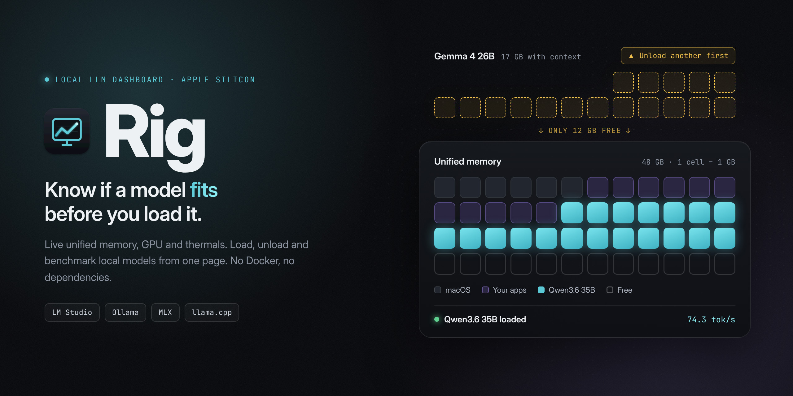
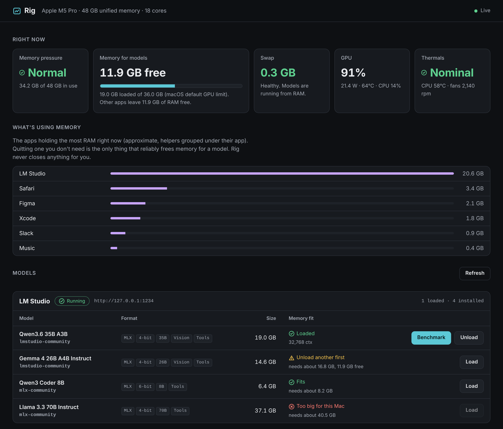
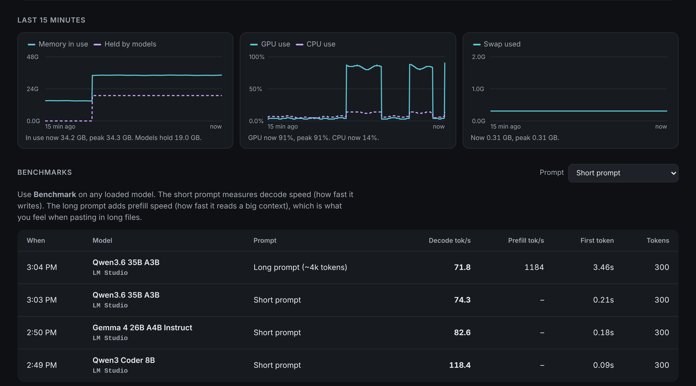

<p align="center">
  
</p>

# Rig

A 35B model loads fine, and then your Mac crawls. It fit under the GPU limit, but Safari, Figma and Slack were already holding 15 GB, so macOS started swapping and tokens dropped to a trickle.

Rig is a small local dashboard for running LLMs on Apple Silicon. It watches unified memory, swap, GPU and thermals, reads the models you have installed, and tells you whether each one will actually fit right now, counting what your other apps are using. You can load, unload and benchmark models from the same page.

It's one Node process with zero dependencies. It only listens on `127.0.0.1`.

<p align="center">
  
</p>

<sub>Screenshots use sample data, not measurements from a real machine.</sub>

## What it does

**Memory fit check.** Every installed model gets a label: Fits, Tight fit, Close apps first, Unload another first, or Too big for this Mac. The estimate checks two limits and uses the tighter one: the GPU memory limit macOS enforces, and the RAM your other apps leave free.

**What's using memory.** A ranked list of the apps holding the most RAM, with helper processes grouped under their parent app. When a model won't fit, this is where you find out what to quit.

**Model control.** Load and unload LM Studio models (through its `lms` CLI) and Ollama models (through its API). If you run `mlx_lm.server` or a llama.cpp server, Rig finds it and can benchmark it.

**Benchmarks.** Decode tok/s, prefill tok/s and time to first token, saved so you can compare models and quantizations over time.

**Honest swap readings.** A large swap total left over from earlier doesn't slow anything. Swap that's growing does. Rig only warns about the second kind.

**Live charts.** Memory, GPU, CPU and swap over the last 15 minutes.

**A Dock app.** One script builds `Rig.app` with its own icon. Click it to start Rig, quit it to stop. Quitting always closes the port.

<p align="center">
  
</p>

## Requirements

- A Mac with Apple Silicon (M1 or later)
- Node.js 18 or newer: `brew install node`
- At least one runtime: [LM Studio](https://lmstudio.ai), [Ollama](https://ollama.com), `mlx_lm.server` or a llama.cpp server
- Optional but recommended: [macmon](https://github.com/vladkens/macmon) for GPU use, power, temperatures and fan speed, with no sudo: `brew install macmon`

## Install

```bash
git clone https://github.com/cdzn77/rig.git
cd rig
node server.js
```

Open http://127.0.0.1:4545.

For LM Studio's load and unload buttons, the `lms` command needs to exist. If Rig says it can't find it, run `~/.lmstudio/bin/lms bootstrap` once.

## Add it to your Dock

```bash
bash launcher/build-app.sh
```

This builds `~/Applications/Rig.app` and opens it in Finder. Drag it onto your Dock.

- **Click it** to start Rig in the background and open the dashboard. If Rig is already running, it just opens the dashboard.
- **Quit it** (right-click the Dock icon, then Quit) to stop Rig. Quitting stops every Rig server, including one started from Terminal, then confirms port 4545 is closed.
- **If the app crashes or is force-quit,** the server notices within 3 seconds and shuts itself down. The port never stays open on its own.
- Server output goes to `~/Library/Logs/Rig.log`.

The app is built on your own Mac, so the first time you open it macOS may say it can't verify the developer. Right-click Rig.app, choose **Open**, then confirm. You only do this once. If you move the `rig` folder later, run `build-app.sh` again.

## How the fit check works

A model's memory need is its size on disk plus a flat allowance for the KV cache (1.5 GB by default). Rig compares that against two numbers:

1. **The GPU memory limit.** By default macOS lets the GPU use about 75% of RAM on Macs with more than 36 GB, and about two thirds on smaller ones. On a 48 GB Mac that's about 36 GB.
2. **The RAM actually free,** after your other apps and a 3 GB safety margin.

A model can pass the first check and fail the second. That's the **Close apps first** label, and it's the most common reason a model that "should fit" runs slowly.

The KV cache allowance assumes a default-sized context, around 8k tokens. Long contexts need much more. If a model labeled Fits still pushes you into swap at a big context length, raise `kvOverheadGB` in your config.

You can raise the GPU limit until the next reboot, which helps if you want two large models loaded at once:

```bash
sudo sysctl iogpu.wired_limit_mb=40960
```

Leave at least 8 GB for macOS and your apps, or the whole machine will start swapping.

## Why there's no "free memory" button

Memory cleaner tools don't do what the name suggests. `sudo purge` mostly empties the disk cache, which is often what makes your next model load fast. Cleaner apps work by pushing other apps into swap, which is the exact slowdown you're trying to avoid. Swap itself only clears on restart.

The only thing that reliably frees memory for a model is quitting an app you don't need. Rig shows you which apps to consider and leaves the decision to you. It never closes anything on its own.

## Configuration

Copy `config.example.json` to `config.json` and change what you need. Every setting is optional.

| Setting | Default | What it does |
|---|---|---|
| `port` | `4545` | Port for the dashboard |
| `lmstudio.port` | `1234` | LM Studio server port |
| `ollama.port` | `11434` | Ollama port |
| `openaiPorts` | `[8080, 8000]` | Ports to check for `mlx_lm.server` or llama.cpp |
| `kvOverheadGB` | `1.5` | Memory allowance for the KV cache, per model |
| `ramReserveGB` | `3` | RAM kept free for macOS when judging fit |

If you change `port`, the Dock app still expects 4545. Edit `rigURL` in `launcher/Rig.applescript` and rebuild.

## Benchmarks

Benchmark sends a fixed prompt through the runtime's OpenAI-compatible endpoint:

- **Decode tok/s:** how fast the model writes. Reasoning tokens count, because thinking models spend real time on them.
- **Prefill tok/s:** how fast it reads the prompt. Only reported for the long prompt, since a short prompt's first-token time is mostly request overhead.
- **First token:** time until the first token arrives.

Benchmark only runs on a loaded model, so load time never skews a result. Results live in `data/bench.json`. For numbers you can compare, close other heavy apps and keep the Mac plugged in.

## Where the numbers come from

| Panel | Source |
|---|---|
| Memory, swap, pressure | `vm_stat`, `sysctl` |
| GPU limit | `iogpu.wired_limit_mb`, or the macOS default |
| GPU, power, temperatures, fans | `macmon` |
| Thermal throttling | `pmset -g therm` |
| Apps using memory | `ps` (resident memory, which slightly overcounts shared memory, so read it as a ranking) |
| LM Studio models | `lms ls`, `lms ps`, plus the files in `~/.lmstudio/models` |
| Ollama | its API on port 11434 |

## Security

Rig binds to `127.0.0.1` only. It refuses requests addressed to any other host name, which blocks DNS rebinding, and refuses cross-site POSTs, so a web page open in another tab can't load or unload your models. It has no login, so don't expose it to your network.

## Status

Rig is new. It was built and tested on an M5 Pro MacBook Pro with 48 GB, running MLX models in LM Studio. The Ollama, `mlx_lm.server` and llama.cpp adapters follow those tools' documented APIs but have had less real-world use. If something reads wrong on your machine, please open an issue and include the output of `~/.lmstudio/bin/lms ls --json` or `macmon pipe -s 1`. Those two commands explain most mismatches.

## Credits

Inspired by [sparkDash](https://mia-ai.net/lab/projects/sparkdash) from Mia's AI Lab, a dashboard for fleets of NVIDIA DGX Sparks. Rig is a separate, smaller tool aimed at a single Mac, and shares no code with it. Hardware readings come from [macmon](https://github.com/vladkens/macmon) by vladkens.

Built by Angelo Manzano Jr. at [ChrowmDesigns](https://chrowmdesigns.com).

## License

[MIT](LICENSE)
